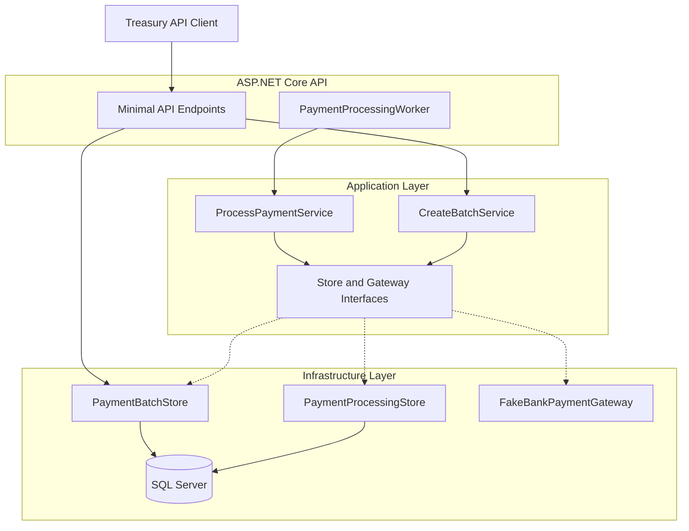
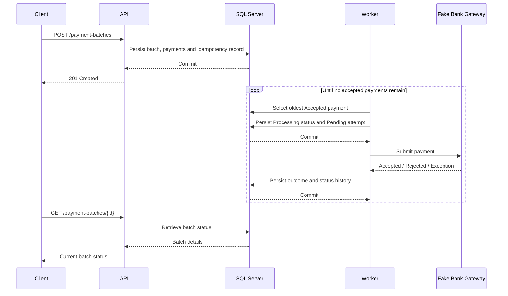
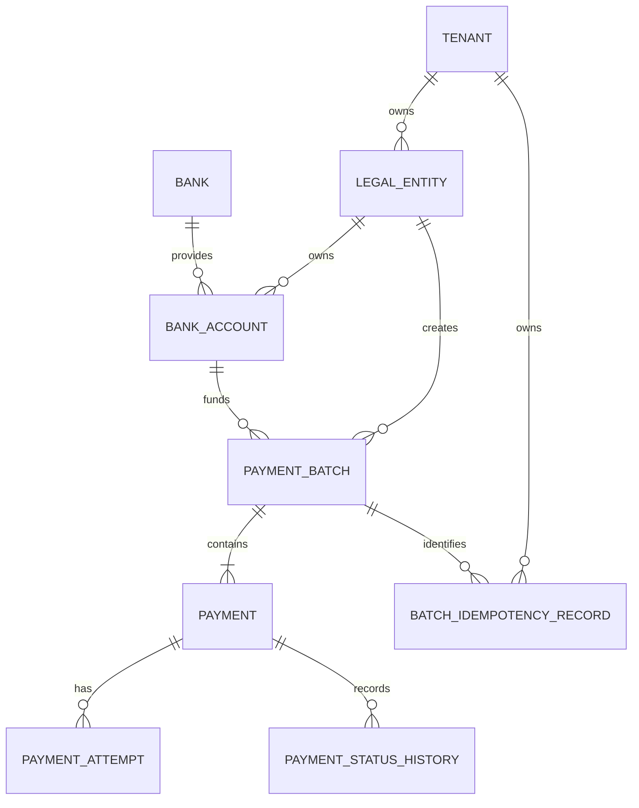
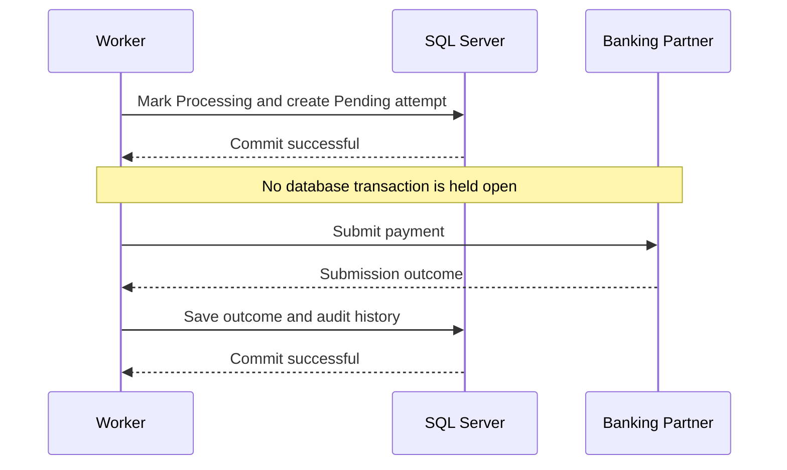
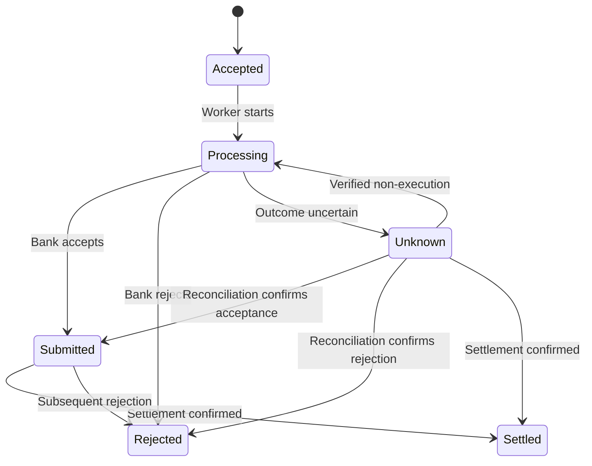
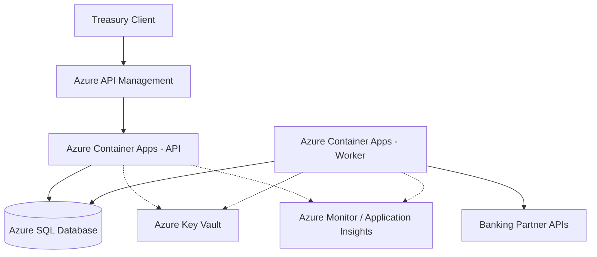

# Payment Batch Processing Service — System Design

Ripple Treasury — Payment Batch Processing Service

## 1. Overview

Corporate treasury teams need to submit large numbers of outbound payments reliably, often across multiple legal entities, currencies and banking partners. Manual processing introduces operational risk, makes failures difficult to investigate and provides limited visibility into the state of individual payments.

This service provides a foundation for accepting payment batches, persisting payment instructions, submitting them asynchronously to a banking partner and recording the outcome of each submission.

The design prioritises financial correctness, auditability and clear separation of responsibilities. In particular, an uncertain bank response must not be treated as a failed payment: the bank may have received and acted upon the instruction even if the response was lost.

The implementation is deliberately limited to a single-instance MVP. It demonstrates the core processing workflow while identifying the additional controls required before handling real funds in production.

### 1.1 Goals

- Accept batches containing multiple outbound payment instructions.
- Validate payment data and enforce tenant and legal-entity boundaries.
- Prevent duplicate batch creation when clients repeat a request.
- Persist batches and payments before beginning asynchronous processing.
- Record payment submission attempts and status transitions.
- Distinguish confirmed acceptance, confirmed rejection and unknown bank outcomes.
- Allow clients to retrieve batch and payment statuses.
- Keep business rules independent of database and bank-specific implementations.

### 1.2 Scope and assumptions

The implemented MVP supports:

- A single source bank account and currency per batch.
- Up to 1,000 payments per batch.
- Asynchronous, sequential payment submission.
- SQL Server persistence using Entity Framework Core.
- A Development-only simulated bank adapter that accepts payment submissions. The application fails at startup outside Development until a real bank gateway is configured.
- Tenant-scoped batch creation and retrieval.
- Idempotent batch creation using a client-provided idempotency key.
- Unit tests for processing outcomes and integration tests against SQL Server.

The following capabilities are deliberately excluded from the implementation:

- Real banking API integration and settlement confirmation.
- Cross-currency conversion and foreign exchange execution.
- Multi-instance or parallel payment processing.
- Automated reconciliation and recovery of uncertain payments.
- Automatic retry of bank submissions.
- Production authentication, authorisation and approval workflows.
- Liquidity checks, account balance reservation and payment scheduling.

These are not considered unnecessary features. They are important production concerns that have been deferred to keep the implemented slice focused and reviewable.

## 2. Architecture

### 2.1 Architectural approach

The solution uses a layered architecture with explicit separation between business rules, application workflows and external dependencies.

| Layer | Responsibility |
|---|---|
| Domain | Entities, payment states, validation and permitted state transitions |
| Application | Batch creation, processing orchestration and infrastructure contracts |
| Infrastructure | EF Core persistence, SQL Server access and simulated bank integration |
| API | HTTP endpoints, request handling, tenant context and background worker |

Dependencies point towards the Domain and Application layers. The Domain has no dependency on EF Core, ASP.NET Core or banking infrastructure.

This allows the core payment rules to be tested without running the API or connecting to a database.

### 2.2 Component diagram

The HTTP API and background worker run in the same application process for the MVP. Each processing operation uses its own dependency injection scope and EF Core `DbContext`.

### 2.3 Architectural decisions and trade-offs

#### Decision 1 — Asynchronous processing rather than synchronous bank submission

**Chosen:** The API persists a batch and returns without waiting for payment submission. A background worker processes the payments afterwards.

**Alternative:** Submit every payment during the original HTTP request.

Synchronous processing is simpler for very small workloads, but becomes unsuitable for batches containing hundreds of payments. Bank latency, timeouts and partial failures would make request duration unpredictable.

Asynchronous processing separates client request reliability from bank availability and allows payment outcomes to be inspected independently.

**Trade-off:** Clients must retrieve the latest status rather than expecting a final result from the initial POST response.

#### Decision 2 — SQL-backed polling rather than a message broker

**Chosen:** A background worker polls the database for the oldest accepted payment.

**Alternative:** Publish payment work to Azure Service Bus or another durable messaging system.

Database polling is straightforward, introduces no additional infrastructure and is sufficient for a single-worker demonstration.

A message broker would provide better workload distribution and operational scalability, but would also require message delivery semantics, deduplication, an outbox strategy and additional infrastructure.

**Trade-off:** The current polling implementation is not safe for multiple active workers. Production scaling requires atomic work claiming or a durable queue with appropriate concurrency controls.

#### Decision 3 — Relational persistence rather than an in-memory or document store

**Chosen:** SQL Server with Entity Framework Core.

**Alternative:** In-memory storage or a document-oriented database.

A relational database provides foreign keys, unique constraints, transactions and structured querying. These properties are valuable for financial operations, where related payment records must remain consistent and auditable.

Entity Framework Core provides maintainable persistence mappings and migrations while keeping the Application layer independent of the database provider.

**Trade-off:** Changing database providers would still require provider-specific configuration, migrations and review of database-specific error handling. The abstraction makes replacement feasible; it does not make it cost-free.

#### Decision 4 — Explicit payment attempts and status history

**Chosen:** Store the current payment status alongside separate payment attempt and status history records.

**Alternative:** Store only the latest status and bank response on the payment.

A single status field is sufficient for displaying current state but does not explain how a payment reached that state.

Separate records make it possible to investigate submission attempts, uncertain outcomes and state transitions.

**Trade-off:** Additional tables and writes increase persistence complexity. This is justified by the need for auditability in financial workflows.

## 3. API and Processing Flow

### 3.1 API endpoints

| Method | Endpoint | Purpose |
|---|---|---|
| POST | `/payment-batches` | Validate and create a payment batch |
| GET | `/payment-batches/{batchId}` | Retrieve batch status and summary |
| GET | `/payment-batches/{batchId}/payments` | Retrieve individual payment statuses |

The POST endpoint requires an `Idempotency-Key` header. Requests also carry an `X-Tenant-Id` header for development tenant identification.

The tenant header is not a production security mechanism. In production, tenant identity must be derived from authenticated and authorised claims.

### 3.2 Batch creation

The batch creation workflow is:

1. Validate the request, payment amounts and required fields.
2. Resolve the tenant context.
3. Verify that the legal entity belongs to the tenant and that the source account belongs to the legal entity.
4. Normalise the request and calculate a deterministic fingerprint.
5. Check for an existing batch with the same tenant and idempotency key.
6. Return the existing result if the fingerprint matches, or reject conflicting reuse of the key.
7. Persist the batch, payments and idempotency record in one database transaction.
8. Return the accepted batch identifier and initial status.

A unique database constraint on the tenant and idempotency key protects against concurrent duplicate creation requests.

This is **API-level idempotency**. It does not guarantee that a banking partner will execute an instruction only once.

### 3.3 Payment submission

The background worker polls for accepted payments approximately every five seconds when idle.

For each selected payment:

1. Load the oldest accepted payment.
2. Change its status from `Accepted` to `Processing`.
3. Change the batch from `Accepted` to `Processing` when its first payment starts.
4. Create a pending payment attempt and a status history record.
5. Commit these changes before contacting the bank.
6. Submit the payment through `IBankPaymentGateway`.
7. Map the bank outcome to `Submitted`, `Rejected` or `Unknown`.
8. Complete the attempt and append the final status transition.
9. Mark the batch `Completed` when no payments remain in `Accepted` or `Processing`.
10. Commit the final changes.

The worker processes one payment at a time, using a fresh dependency injection scope for each operation.

### 3.4 Submission sequence

The simulated bank currently returns successful acceptance. Rejection and uncertain-outcome handling are exercised through tests.

### 3.5 Meaning of payment and batch statuses

Payment submission and payment settlement are separate concepts.

`Submitted` means the banking partner has accepted the submission. It does **not** mean that funds have been transferred or settled.

`Unknown` means the service cannot reliably determine whether the bank received or executed the instruction. Such payments are not automatically retried.

`Completed` means the batch's submission processing phase has finished. A completed batch may contain submitted, rejected or unknown payments.

This distinction prevents the API from presenting submission acceptance as confirmed financial settlement.

## 4. Data Model and Storage Strategy

### 4.1 Core entities

The data model separates organisational ownership, payment instructions, bank submission attempts and audit history.

| Entity | Responsibility |
|---|---|
| `Tenant` | Represents a corporate customer and establishes the tenant boundary |
| `LegalEntity` | Represents an organisation within a tenant that owns bank accounts and initiates payments |
| `Bank` | Identifies a banking partner |
| `BankAccount` | Represents a source account associated with a legal entity and bank |
| `PaymentBatch` | Groups payment instructions sharing a source account and currency |
| `Payment` | Stores an individual outbound payment instruction and its current status |
| `PaymentAttempt` | Records an attempt to submit a payment to a bank and its outcome |
| `PaymentStatusHistory` | Records transitions between payment statuses |
| `BatchIdempotencyRecord` | Associates a tenant-scoped idempotency key and request fingerprint with a created batch |

### 4.2 Entity relationships

A batch has one source account and one currency. Each payment has its own amount, beneficiary details, reference and processing status.

The data model supports multiple banking partners through bank and bank-account relationships, although the MVP uses a single simulated bank adapter rather than real bank-specific integrations.

### 4.3 Monetary precision and validation

Payment amounts use the .NET `decimal` type rather than binary floating-point types. SQL Server stores monetary values using `decimal(19,4)`.

This avoids the rounding behaviour associated with binary floating-point arithmetic and provides a defined storage precision.

The Domain layer validates positive amounts and enforces the configured precision and maximum value.

The MVP assumes that a payment's currency is inherited from its batch. It does not perform foreign exchange conversion or validate currency-specific minor-unit rules.

A production implementation would introduce explicit currency metadata, including supported precision, payment limits and bank-specific constraints.

### 4.4 Database integrity

The database uses foreign keys to preserve relationships between tenants, legal entities, accounts, batches, payments and audit records.

A unique constraint on `(TenantId, IdempotencyKey)` prevents duplicate batch creation for the same tenant and key.

Payment attempts and status history are stored separately from the current payment state. The current status supports efficient reads; the historical records support investigation and operational audit.

Status history is append-only by application design. Stronger database permissions and retention controls would be required to make the audit trail tamper-resistant in production.

### 4.5 Storage abstraction

The Application layer defines persistence contracts such as `IPaymentBatchStore` and `IPaymentProcessingStore`.

Infrastructure implements these contracts using Entity Framework Core and SQL Server.

This isolates application workflows from EF Core queries and database-specific persistence details. It also makes unit testing possible without a database.

The abstraction does not imply that database replacement is automatic. Moving to another relational database would require new provider configuration, migrations and review of provider-specific behaviour, particularly unique-constraint handling and concurrency guarantees.

## 5. Consistency and Concurrency

### 5.1 Transaction boundaries

The system uses database transactions for operations that must be committed together.

**Batch creation**

The batch, its payments and the idempotency record are persisted in a single database transaction.

This prevents a partially created batch from being committed.

**Starting payment processing**

The payment transition from `Accepted` to `Processing`, the pending attempt and the initial status history record are committed together.

The batch also moves to `Processing` when its first payment starts.

**Completing payment processing**

The payment outcome, completed attempt, status history and any batch completion transition are committed together.

These boundaries ensure that related database records remain consistent when a database operation fails.

### 5.2 Why the bank call is outside the database transaction

A bank submission is an external side effect. It cannot participate in the SQL Server transaction.

Keeping a database transaction open while waiting for a banking partner would increase lock duration, resource usage and contention without making the bank operation atomic.

The service therefore commits the processing attempt before calling the bank and commits the result afterwards.

This design makes processing attempts durable before submission, but it does not provide atomicity across SQL Server and the banking partner.

A failure between the bank call and the final database commit can leave the recorded state uncertain.

### 5.3 Current concurrency model

The MVP uses one background worker that processes payments sequentially.

The worker selects the oldest `Accepted` payment, marks it as `Processing` and persists the change before submission.

This is sufficient for a single running instance, but the selection and update are not an atomic claim.

If multiple service instances run concurrently, two workers could read the same accepted payment before either commits its status change. Both could then attempt submission.

The single-worker constraint also avoids concurrent batch-completion races in the MVP. A multi-worker implementation would require both atomic payment claiming and concurrency-safe batch finalisation.

**The current implementation must therefore not be deployed with multiple active processing workers.**

The MVP does not claim exactly-once bank submission guarantees.

### 5.4 Production concurrency strategy

Before scaling horizontally, payment claiming must be made atomic.

A production design could use a SQL-backed claim mechanism with:

- A conditional update that claims only eligible payments.
- A claim owner and lease expiry.
- A fencing token or equivalent mechanism to reject stale workers.
- A bounded number of processing attempts.
- Explicit recovery rules for abandoned work.

Alternatively, Azure Service Bus could distribute payment work, with a transactional outbox ensuring that committed database changes are eventually published.

Neither approach removes the need for bank-side idempotency and reconciliation.

The database can prevent concurrent local state transitions, but it cannot independently guarantee that a banking partner has executed an instruction only once.

### 5.5 Idempotency and duplicate prevention

Two distinct forms of idempotency are required.

**Batch creation idempotency — implemented**

Clients provide an idempotency key. The service stores the key and a fingerprint of the normalised request.

Repeating the same request with the same key returns the existing batch. Reusing the key for a different request is rejected.

The unique database constraint protects this behaviour under concurrent creation requests.

**Bank submission idempotency — not implemented**

A network timeout may occur after the bank has received the instruction. Retrying with a new submission identifier could result in a duplicate transfer.

Production bank adapters should use stable, bank-supported idempotency or instruction identifiers where available.

Where a banking partner does not support reliable idempotency, reconciliation and explicit operational controls are necessary before resubmission.

## 6. Failure Handling and Recovery

### 6.1 Payment state machine

The Domain model defines permitted state transitions. Not all transitions have an automated application workflow in the MVP.

In particular, settlement and reconciliation transitions are represented in the Domain but are not implemented as operational processing flows.

### 6.2 Confirmed bank acceptance

When the bank confirms acceptance:

- The payment becomes `Submitted`.
- The attempt becomes `Accepted`.
- The bank reference is recorded.
- A `Processing → Submitted` history entry is appended.

Acceptance is not equivalent to settlement.

### 6.3 Confirmed bank rejection

When the bank explicitly rejects a payment:

- The payment becomes `Rejected`.
- The attempt becomes `Rejected`.
- The rejection reason is recorded.
- A `Processing → Rejected` history entry is appended.

The payment is not automatically resubmitted.

### 6.4 Timeout or uncertain bank response

When the bank submission fails without a reliable outcome, the service records:

- Payment status `Unknown`.
- Attempt outcome `Unknown`.
- A reason explaining the uncertainty.
- A `Processing → Unknown` status history entry.

This includes bank timeouts and exceptions, missing or unsupported submission outcomes, and an accepted response without a valid bank reference.

These cases are deliberately treated differently from a confirmed bank rejection. A missing or incomplete response does not prove that the bank failed to receive or execute the instruction.

The worker selects only `Accepted` payments, so an `Unknown` payment is not automatically resubmitted.

Integration tests verify that uncertain outcomes are persisted and that subsequent processing cycles do not automatically resubmit affected payments.

### 6.5 Process crashes and incomplete attempts

The most significant remaining failure window is a process crash after a payment has been marked `Processing`.

Possible scenarios include:

| Failure point | Persisted state | Risk |
|---|---|---|
| Before the initial processing commit | `Accepted` | Payment remains eligible for later processing |
| After the initial commit, before the bank call | `Processing`, pending attempt | Payment may remain stuck without being submitted |
| During the bank call | `Processing`, pending attempt | Bank outcome may be unknown |
| After bank acceptance, before the final commit | `Processing`, pending attempt | Bank may have accepted the instruction, but the database does not reflect it |
| After the final commit | Final payment and attempt statuses | Submission outcome is durably recorded |

After a bank response has been received, the service uses a separate, bounded cancellation token for final persistence rather than the worker's shutdown token. This allows the service to attempt to record the bank outcome even when application shutdown has been requested.

This reduces the risk of losing a known bank response during graceful shutdown, but it does not guarantee persistence during abrupt process termination, database failure or an exceeded persistence timeout.

The MVP does not automatically recover payments left in `Processing` with pending attempts.

This is intentional: automatically resubmitting such payments could duplicate a transfer if the bank had already accepted the original instruction.

Production recovery would identify stale attempts, investigate their bank-side status and reconcile the outcome before deciding whether another submission is permitted.

### 6.6 Controlled retry after verified non-execution

A payment with an unknown outcome should be retried only after reliable evidence establishes that the previous instruction was not executed.

A production recovery workflow would:

1. Retrieve the payment and its previous attempts.
2. Query the banking partner or obtain an authorised operational confirmation.
3. Record the evidence and identity of the actor approving recovery.
4. Verify that no conflicting recovery operation is in progress.
5. Create a new attempt with an appropriate bank-side idempotency strategy.
6. Submit the instruction and record the resulting state transition.

The Domain model includes a transition for resuming processing after verified non-execution, but the MVP does not expose a complete recovery workflow.

This is a deliberate scope decision rather than an implicit assumption that retrying is safe.

### 6.7 Batch completion semantics

A batch moves to `Completed` once its payments have finished the submission phase.

For the MVP, the terminal submission statuses are:

- `Submitted`
- `Rejected`
- `Unknown`

A completed batch can therefore contain a mixture of accepted submissions, rejected instructions and uncertain outcomes.

`Completed` must not be interpreted as successful settlement of every payment.

For a production system, additional aggregate reporting would make this clearer, for example counts of submitted, rejected, unknown and settled payments.

A separate reconciliation lifecycle may also be appropriate rather than overloading the submission batch status.

## 7. Security and Tenant Isolation

### 7.1 Current tenant isolation

The MVP models multiple corporate tenants, each containing one or more legal entities.

Batch creation verifies that the selected legal entity belongs to the requesting tenant and that the source bank account belongs to that legal entity.

Batch retrieval is tenant-scoped. Requests for batches belonging to another tenant do not expose their contents.

For local development, tenant identity is provided through the `X-Tenant-Id` HTTP header.

**This header is not a secure authentication mechanism.** A client can supply an arbitrary tenant identifier, so the current approach must not be used to protect real customer data.

### 7.2 Production authentication and authorisation

A production deployment would use Microsoft Entra ID or another trusted identity provider to authenticate API clients.

Tenant identity would be derived from validated access-token claims rather than client-controlled headers.

Authorisation would enforce permissions at multiple levels:

- Tenant membership and access.
- Legal-entity and bank-account permissions.
- Payment creation and batch submission privileges.
- Separation of duties for high-value payments and recovery operations.
- Explicit authorisation for reconciliation and controlled resubmission.

For treasury operations, payment approval should be distinct from payment creation where appropriate.

A production workflow could require maker-checker approval, with configurable thresholds and dual authorisation for sensitive operations.

### 7.3 Secrets and sensitive data

Bank API credentials, signing keys and database secrets must not be stored in source control.

Production infrastructure should use managed identities where supported and Azure Key Vault for secrets and certificates.

Payment data, including beneficiary account identifiers, should be treated as sensitive financial information.

Controls should include encryption in transit, encryption at rest, least-privilege database access and restricted access to operational logs.

Logs must not contain complete bank account identifiers, authentication tokens or banking credentials.

### 7.4 Audit and operational accountability

The existing payment status history and attempt records provide an application-level audit trail of processing activity.

Production audit requirements would additionally include:

- Authenticated actor identity for user-initiated actions.
- Approval and recovery decisions.
- Bank reconciliation evidence.
- Changes to payment instructions and configuration.
- Defined retention and access policies.
- Protection against unauthorised modification or deletion of audit records.

Application-level append-only behaviour alone is not sufficient to establish tamper-resistant financial audit storage.

## 8. Observability and Operations

### 8.1 Current implementation

The MVP uses ASP.NET Core logging and a request logging middleware.

The middleware records request information, response status and execution duration. The processing service logs payment outcomes and uncertain bank responses.

The background worker logs startup, shutdown and processing errors.

This provides basic visibility during local development, but does not constitute a complete production monitoring solution.

### 8.2 Structured logging

Production logging should use consistent structured fields, including:

| Field | Purpose |
|---|---|
| `CorrelationId` | Connects related HTTP and background operations |
| `TenantId` | Identifies the tenant within authorised operational contexts |
| `BatchId` | Identifies the affected batch |
| `PaymentId` | Identifies the affected payment |
| `AttemptId` | Identifies a particular bank submission attempt |
| `BankId` | Identifies the banking partner |
| `Outcome` | Records accepted, rejected or uncertain submission outcomes |
| `DurationMs` | Measures processing and external-call latency |

A correlation identifier should be propagated from the API into background processing through persisted metadata or trace context.

The MVP does not currently provide complete end-to-end trace propagation across the HTTP request and asynchronous worker.

### 8.3 Metrics

The following metrics would be important in production:

| Metric | Operational value |
|---|---|
| Payments submitted per minute | Throughput and capacity planning |
| Accepted, rejected and unknown outcomes | Bank integration health |
| Pending payment count | Processing backlog |
| Oldest accepted payment age | Detecting stalled processing |
| Stale processing attempt count | Detecting possible crashes or unresolved submissions |
| Bank submission latency | External dependency performance |
| Batch completion duration | End-to-end processing performance |
| Reconciliation backlog | Outstanding financial uncertainty |

Metrics should be segmented carefully by banking partner and environment, without exposing sensitive customer data through metric labels.

### 8.4 Alerts and operational response

Production alerts should focus on actionable conditions rather than individual transient errors.

Examples include:

- A sustained increase in unknown bank outcomes.
- A growing payment backlog or excessive queue age.
- Processing attempts remaining pending beyond an agreed threshold.
- Repeated failures against a banking partner.
- Database connectivity failures.
- Reconciliation items exceeding operational service levels.

An unknown outcome should trigger investigation and reconciliation, not an automatic resubmission.

Operational runbooks should describe how to identify affected payments, inspect attempts, contact the bank and record the resolution.

### 8.5 Distributed tracing

OpenTelemetry could provide tracing across API requests, application services, database operations and banking integrations.

Azure Application Insights would provide centralised traces, logs and performance diagnostics.

For asynchronous processing, trace context should be propagated explicitly rather than assuming that the original HTTP request span remains active.

## 9. Azure Deployment and Operations

### 9.1 Proposed production architecture

The recommended Azure architecture separates the public API from payment processing so that each can scale and deploy independently.

This diagram represents a **proposed production deployment**, not the infrastructure implemented in the repository.

The current MVP runs the API and background worker in the same process. A production deployment would separate them and introduce safe work-claiming before allowing multiple worker replicas.

### 9.2 Hosting strategy

**Recommended: Azure Container Apps**

Azure Container Apps would host the ASP.NET Core API and, after separation, a dedicated payment processing worker.

This provides container-based deployment, managed scaling, revision management and integration with Azure monitoring.

The API could scale according to HTTP demand. Worker scaling would remain constrained until the concurrency model supports multiple active processors.

An alternative is Azure App Service, which offers a straightforward deployment model for the existing combined API and worker.

App Service may be simpler for an initial single-instance deployment, but the worker's lifecycle must be considered carefully during restarts, deployments and scaling.

The MVP should not be scaled horizontally merely by increasing the number of replicas.

### 9.3 Database

Azure SQL Database is the natural production target because the application already uses SQL Server and EF Core migrations.

The deployment would require:

- Private network connectivity where feasible.
- Encrypted connections.
- Least-privilege database identities.
- Automated backups and point-in-time restore.
- Defined recovery objectives.
- Monitoring for performance, availability and storage.
- A controlled schema migration process.

Database migrations should be executed as a deliberate deployment step, not automatically by every application replica at startup.

### 9.4 Identity, secrets and networking

Managed identities should be used for Azure resource access wherever supported.

Azure Key Vault would hold bank integration credentials, signing certificates and any secrets that cannot be replaced by managed identity.

Production networking should restrict direct database access and control outbound communication with banking partners.

Where banking partners require static outbound IP addresses, private connectivity or mutual TLS, these requirements must be incorporated into the network and certificate-management design.

### 9.5 CI/CD and release strategy

A production delivery pipeline would:

1. Restore dependencies and build the solution.
2. Run unit tests.
3. Run SQL Server integration tests against an isolated test database.
4. Perform security and dependency checks.
5. Build and publish versioned container images.
6. Apply reviewed database migrations.
7. Deploy the API and worker using controlled rollout procedures.
8. Run smoke tests and verify operational health.

Database changes should favour backward-compatible migrations to support safe deployments and rollback of application code.

Worker deployments require particular care: stopping a process during a bank submission may leave an unresolved processing attempt.

A graceful shutdown can reduce this risk, but cannot eliminate it. Reconciliation remains necessary.

### 9.6 Availability and disaster recovery

A production service would define recovery time and recovery point objectives based on treasury operational requirements.

Azure SQL backup and restore capabilities would protect persisted state.

However, restoring a database to an earlier point does not reverse instructions already accepted by a bank.

After a restore or regional recovery event, the system must reconcile potentially affected submissions before resuming processing.

This is a financial consistency requirement, not merely an infrastructure recovery concern.

## 10. Testing Strategy

### 10.1 Unit tests

Unit tests exercise application behaviour without requiring SQL Server or a running HTTP server.

The processing tests cover:

- Confirmed bank acceptance.
- Confirmed bank rejection.
- Unknown outcome following a bank exception.

Additional tests cover HTTP exception handling and related application behaviour.

These tests provide fast feedback on business logic and status transitions.

### 10.2 Integration Tests

SQL Server integration tests exercise the persistence and processing behaviour against a dedicated SQL Server LocalDB database.

The tests cover:

- Successful processing of a batch containing two payments, including persisted payment attempts, status history and batch completion.
- Uncertain bank outcomes, including timeouts, missing responses and accepted responses without a valid bank reference.
- Prevention of automatic resubmission for payments in the `Unknown` state.
- Persistence of a known bank outcome when worker cancellation occurs after bank acceptance.
- Concurrent batch creation using the same tenant and idempotency key with matching request fingerprints, verifying that only one batch, payment and idempotency record are persisted.
- Concurrent batch creation using the same tenant and idempotency key with different request fingerprints, verifying that one creation succeeds, the other results in an idempotency conflict, and no duplicate records are persisted.
- Transaction rollback when a foreign key constraint is violated during batch persistence, verifying that no partial records remain.

The concurrency tests verify database-backed idempotency during concurrent batch creation attempts. They do not establish safe payment claiming across multiple worker instances.

The rollback test verifies the atomicity of a single EF Core `SaveChangesAsync` operation when persistence fails.

A database guard validates the configured database name and SQL Server LocalDB instance before test contexts are created.

### 10.3 Testing Limitations

The current automated tests do not establish production readiness.

Important missing coverage includes:

- Deterministic concurrency stress testing and concurrent payment claiming across multiple worker instances.
- Process termination during bank submission.
- Database failure after a successful bank response.
- Real banking API contract tests.
- Security and authorisation testing.
- Load testing with large batches.
- Deployment and disaster recovery testing.

The concurrent batch creation tests verify the expected outcomes for matching and conflicting request fingerprints. However, they do not guarantee that a database uniqueness conflict occurs during every execution.

They also do not establish safe concurrent payment processing across multiple worker instances.

These scenarios should be prioritised as the system moves towards production.

## 11. Production Roadmap

The roadmap prioritises financial safety before throughput or feature expansion.

### Phase 1 — Establish safe payment execution

**Highest priority**

- Integrate with a real banking partner using supported authentication and signing mechanisms.
- Introduce stable bank-side instruction identifiers and idempotency where supported.
- Implement reconciliation of uncertain and incomplete attempts.
- Add an explicit, authorised recovery workflow.
- Implement atomic work claiming and protection against stale workers.
- Add production authentication, authorisation and approval controls.

These capabilities are prerequisites for safely processing real funds.

### Phase 2 — Improve operational reliability

- Separate the API and worker deployments.
- Add centralised monitoring, tracing and alerting.
- Implement operational dashboards and recovery runbooks.
- Introduce a transactional outbox and durable messaging if throughput or reliability requirements justify it.
- Expand integration, concurrency and failure-injection testing.
- Define backup, restore and incident response procedures.

### Phase 3 — Extend treasury functionality

- Support bank-specific routing and multiple banking partners.
- Add payment scheduling, cut-off times and business calendars.
- Implement settlement confirmation and reconciliation reporting.
- Introduce liquidity and available-balance checks.
- Support configurable approval workflows and payment limits.
- Add foreign exchange workflows where required.

These features should be driven by validated product and operational requirements rather than introduced speculatively.

## 12. Summary

The implemented service demonstrates a focused payment batch processing workflow with persistent instructions, idempotent batch creation, asynchronous submission, explicit payment attempts and auditable status transitions.

The central design principle is that **uncertainty must be represented explicitly**.

A missing bank response is not evidence that a payment failed, and retrying an uncertain instruction without reconciliation can create duplicate transfers.

The MVP intentionally trades horizontal scalability and automated recovery for a smaller, understandable implementation. Those limitations are documented, together with the controls required to address them.

The proposed production architecture builds on the same separation between Domain, Application and Infrastructure while adding safe concurrency, reconciliation, operational security and Azure-based deployment.

This provides a maintainable foundation without presenting the current implementation as production-ready.